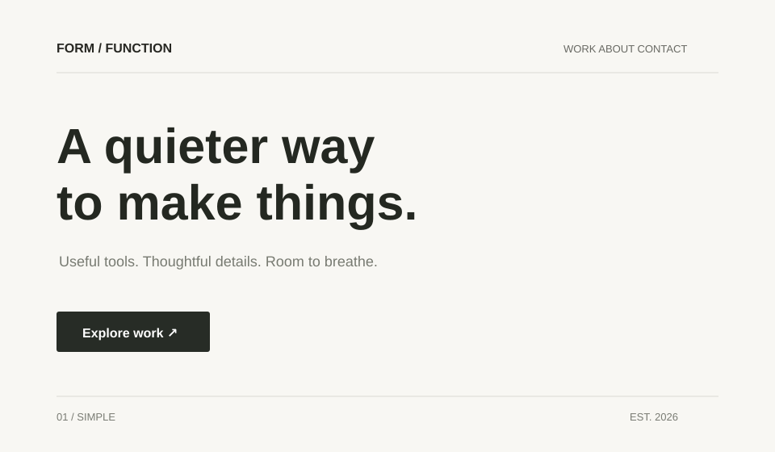

# 极简主义 · Minimalism

## 视觉特征

留白、克制的配色、清晰的字体层级，让内容成为主角。

## 常见用途

品牌官网、作品集、专注型工具。

## 示例配色

`#f8f7f3 · #272c26 · #777a71`

## 使用时留意

页面可能显得单薄；需要认真处理排版、间距和对比度。

> 图片是原创的示意界面，用于表达风格，不代表任何现成产品的完整设计规范。
