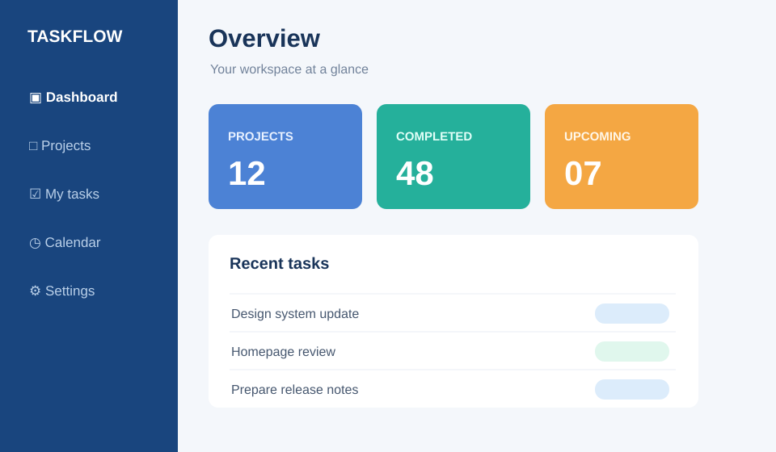

# 扁平化 · Flat Design

## 视觉特征

用纯色、简单图标和规整卡片组织信息，减少材质模拟。

## 常见用途

移动应用、后台、轻量产品。

## 示例配色

`#19457e · #4c82d5 · #25b09b`

## 使用时留意

不要让按钮与普通色块难以区分；用状态、文案和对比建立交互提示。

> 图片是原创的示意界面，用于表达风格，不代表任何现成产品的完整设计规范。
