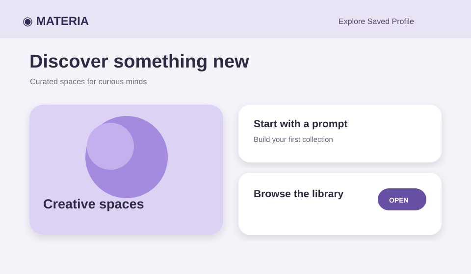

# Material Design · Material Design 3

## 视觉特征

以色彩角色、层级、圆角组件和动效构建统一界面。

## 常见用途

跨平台应用、功能较多的产品。

## 示例配色

`#6750a4 · #e9e4f5 · #2f2942`

## 使用时留意

参考官方组件规范，同时建立自己的品牌色和排版。

> 图片是原创的示意界面，用于表达风格，不代表任何现成产品的完整设计规范。
