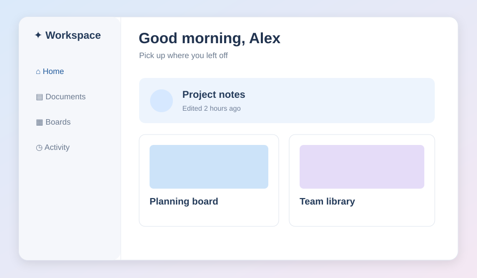

# Fluent Design · Fluent 2

## 视觉特征

柔和的表面、圆角、细边框与交互反馈，带有桌面软件气质。

## 常见用途

办公工具、桌面客户端、协作应用。

## 示例配色

`#edf4fd · #235c9d · #243b5a`

## 使用时留意

保持信息层级清楚；透明与阴影只用于需要强调的层。

> 图片是原创的示意界面，用于表达风格，不代表任何现成产品的完整设计规范。
