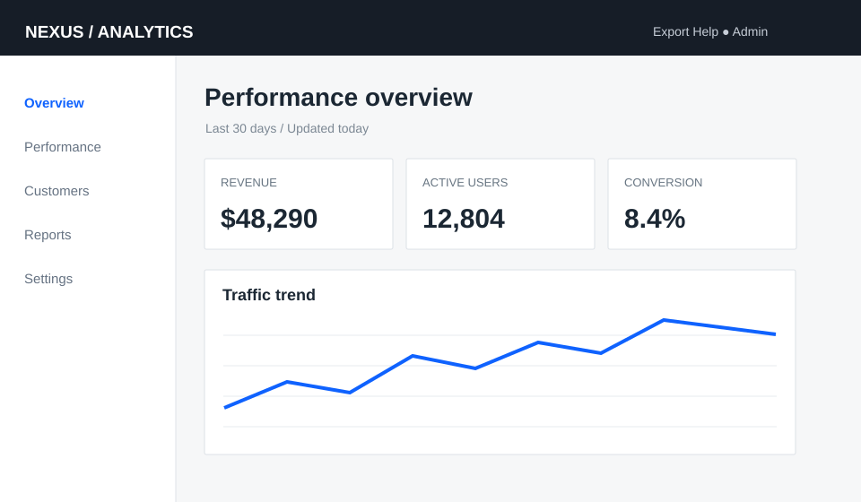

# 企业数据风 · Enterprise Data

## 视觉特征

稳定网格、密集而有序的信息、表格与图表，优先支持高效操作。

## 常见用途

SaaS、运营后台、数据分析。

## 示例配色

`#161d27 · #0f62fe · #f6f7f8`

## 使用时留意

数字、表格和筛选器的可读性比装饰更重要。

> 图片是原创的示意界面，用于表达风格，不代表任何现成产品的完整设计规范。
