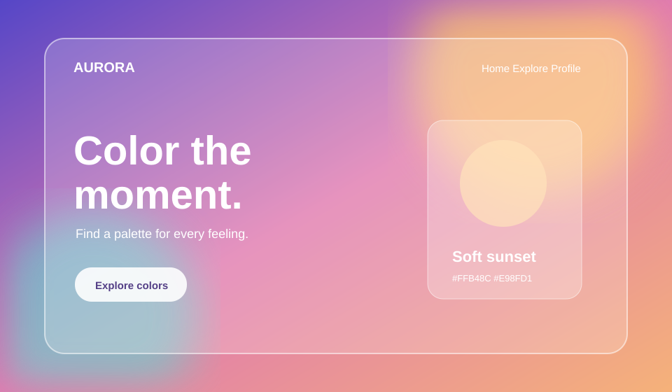

# 玻璃拟态 · Glassmorphism

## 视觉特征

半透明面板、背景模糊、浅边框和叠层制造磨砂玻璃感。

## 常见用途

天气、音乐、创意展示、活动页。

## 示例配色

`#5546c7 · #e07aaf · #ffcd6a`

## 使用时留意

复杂背景会降低文字对比度；正文区域要有足够清晰的底色。

> 图片是原创的示意界面，用于表达风格，不代表任何现成产品的完整设计规范。
