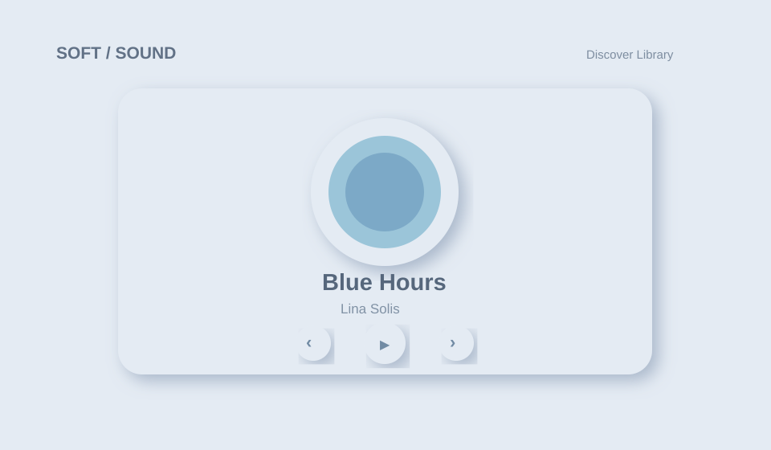

# 新拟态 · Neumorphism / Soft UI

## 视觉特征

同色表面配合柔和高光与阴影，呈现轻微凸起或凹陷。

## 常见用途

音乐控件、概念展示、小面积装饰。

## 示例配色

`#e4ebf3 · #7ca9c7 · #56677c`

## 使用时留意

低对比效果可能影响可访问性；核心按钮需要明显的边界与状态。

> 图片是原创的示意界面，用于表达风格，不代表任何现成产品的完整设计规范。
