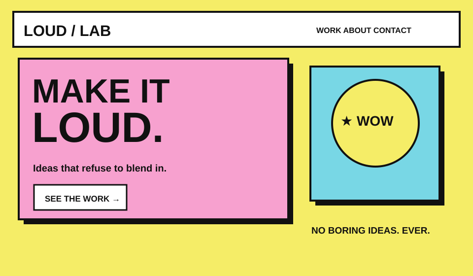

# 新粗野主义 · Neo-brutalism

## 视觉特征

粗边框、硬阴影、鲜艳色块和夸张字体，表达强烈个性。

## 常见用途

创意品牌、作品集、趣味产品。

## 示例配色

`#f5ed67 · #f7a1cf · #111111`

## 使用时留意

强烈视觉可能干扰长时间阅读；信息密集页要适度收敛。

> 图片是原创的示意界面，用于表达风格，不代表任何现成产品的完整设计规范。
