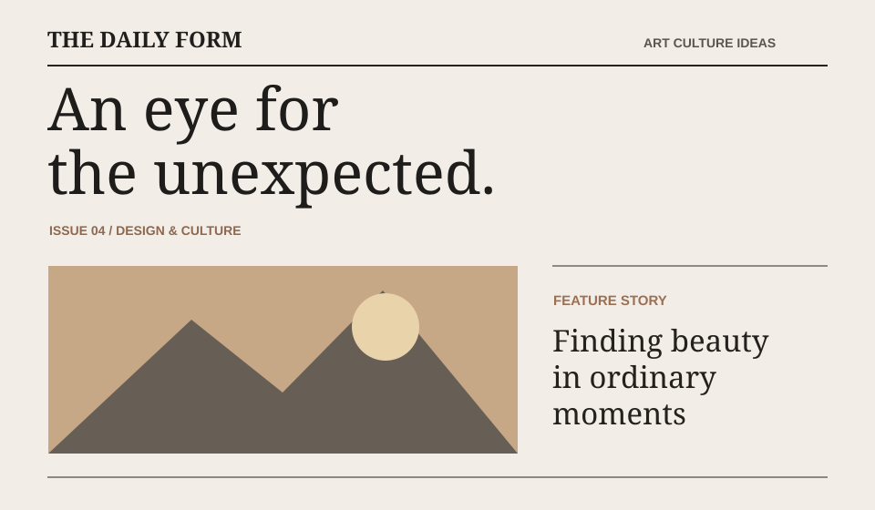

# 编辑杂志风 · Editorial

## 视觉特征

大标题、衬线字体、图文交错和精心控制的留白，强调阅读节奏。

## 常见用途

媒体、摄影、品牌故事、作品集。

## 示例配色

`#f2eee7 · #1e1d1b · #c6a886`

## 使用时留意

移动端需重新安排图文顺序，避免标题过大造成拥挤。

> 图片是原创的示意界面，用于表达风格，不代表任何现成产品的完整设计规范。
