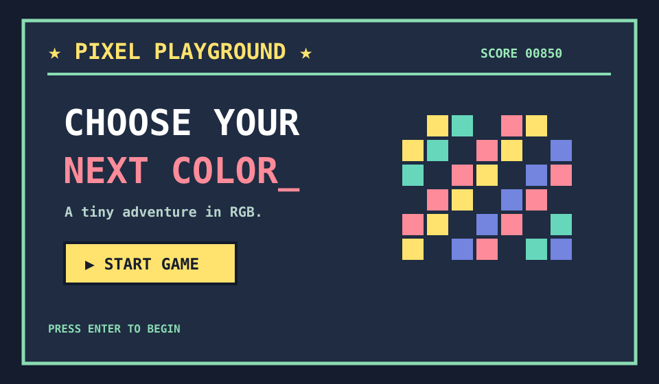

# 像素风 / 复古游戏风 · Pixel / Retro

## 视觉特征

像素块、等宽字、有限色盘和游戏界面元素带来复古趣味。

## 常见用途

小游戏、实验作品、趣味工具。

## 示例配色

`#141c2e · #ffe36e · #fe8b99`

## 使用时留意

正文不要全部使用低分辨率字体；让游戏元素服务于实际操作。

> 图片是原创的示意界面，用于表达风格，不代表任何现成产品的完整设计规范。
