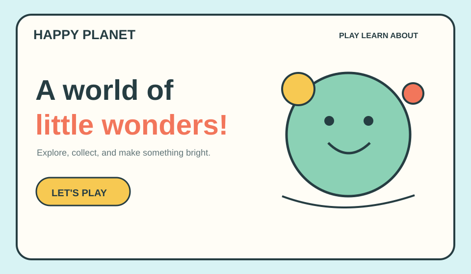

# 2D 卡通风 · 2D Cartoon

## 视觉特征

平面角色、清楚的轮廓线、纯色填充和轻快的互动气氛。

## 常见用途

儿童产品、休闲游戏、教学工具。

## 示例配色

`#d8f3f4 · #8bd1b5 · #f2765b`

## 使用时留意

角色和控件保持一致的线宽与色盘，避免装饰影响导航。

> 图片是原创的示意界面，用于表达风格，不代表任何现成产品的完整设计规范。
