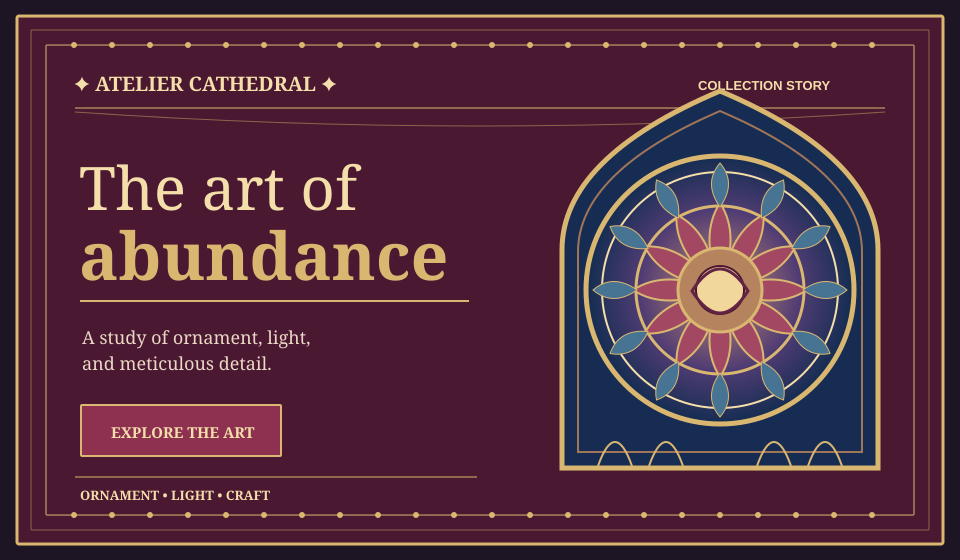

# 华丽极繁主义 / 哥特装饰 · Ornate Maximalism

## 视觉特征

以中世纪哥特教堂为灵感：尖拱、玫瑰窗、花饰细线、宝石色与金色层层叠加，强调精致工艺和仪式感。

## 常见用途

艺术展览、奇幻叙事、珠宝与高端文化品牌。

## 示例配色

`#4b1831 · #162c53 · #d9b770`

## 使用时留意

华丽来自细节与秩序；让装饰围绕主视觉与文字展开，正文仍需清晰。此例借鉴教堂建筑装饰，不代表所有极繁主义。

## 进一步参考

- [V&A：哥特风格中的彩窗与装饰](https://www.vam.ac.uk/articles/the-gothic-style-an-introduction)

> 图片是原创的示意界面，用于表达风格，不代表任何现成产品的完整设计规范。
