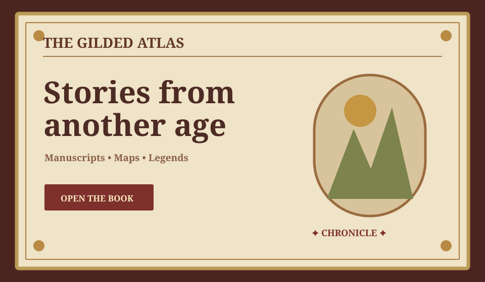

# 中世纪手抄本风 · Medieval Manuscript

## 视觉特征

羊皮纸底色、装饰边框、衬线字与手抄本式插图。这里展示的是欧洲手抄本方向。

## 常见用途

历史内容、奇幻游戏、博物馆专题。

## 示例配色

`#efe3c8 · #7e302d · #b88a43`

## 使用时留意

中世纪跨越多个地区与传统；具体项目应先确定时代和地域。

## 进一步参考

- [Getty：中世纪手抄本](https://www.getty.edu/art/exhibitions/scriptorium/)

> 图片是原创的示意界面，用于表达风格，不代表任何现成产品的完整设计规范。
