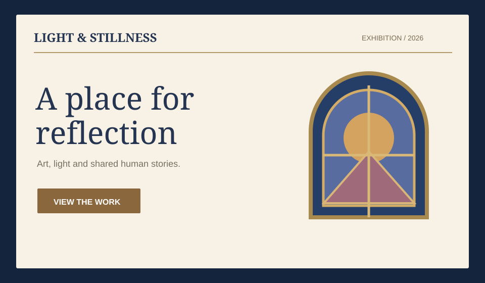

# 宗教艺术启发 / 彩窗 · Sacred Art / Stained Glass

## 视觉特征

以宁静的留白、光线与彩窗结构表达神圣空间感；示例具体采用基督教哥特彩窗语汇。

## 常见用途

展览、历史文化内容、相关社群项目。

## 示例配色

`#14243d · #d3a35f · #9f6b7a`

## 使用时留意

宗教传统各不相同，实际使用时应明确对象并核对符号含义。

## 进一步参考

- [大都会艺术博物馆：宗教图像的跨文化差异](https://www.metmuseum.org/de/perspectives/virgin-mary-guanyin)

> 图片是原创的示意界面，用于表达风格，不代表任何现成产品的完整设计规范。
