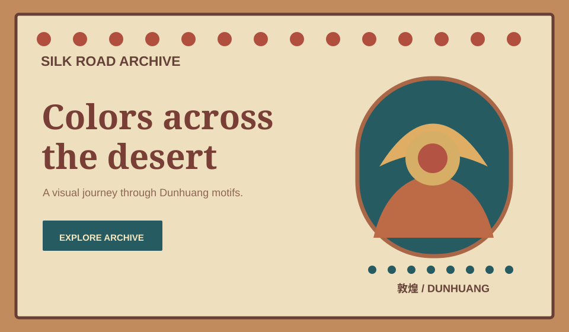

# 西域 / 敦煌艺术启发 · Silk Road / Dunhuang

## 视觉特征

借鉴敦煌装饰的青绿、赭红、金色及莲花、卷草等纹样，形成壁画与丝路气质。

## 常见用途

文化展览、历史教育、旅游专题。

## 示例配色

`#255b61 · #b25344 · #dfad63`

## 使用时留意

“西域”涵盖广阔地区，不能用一套图案概括；此图只聚焦敦煌启发。

## 进一步参考

- [敦煌研究院：莫高窟装饰图案](https://www.dha.ac.cn/info/1425/3618.htm)

> 图片是原创的示意界面，用于表达风格，不代表任何现成产品的完整设计规范。
