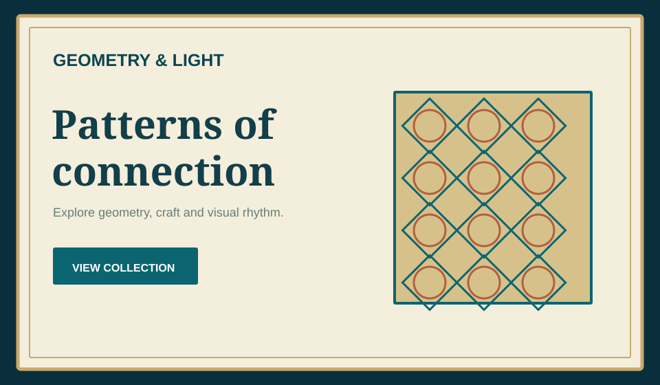

# 伊斯兰艺术启发 / 几何纹样 · Islamic Geometric

## 视觉特征

重复的几何纹样、对称节奏、植物纹与书法传统；示例只采用抽象几何。

## 常见用途

文化展览、工艺档案、建筑专题。

## 示例配色

`#092f3d · #caa96a · #b15f3d`

## 使用时留意

“穆斯林风格”并非单一风格；涉及经文或书法时须确保文字准确且使用得体。

## 进一步参考

- [大都会艺术博物馆：伊斯兰艺术几何纹样](https://www.metmuseum.org/es/essays/geometric-patterns-in-islamic-art)

> 图片是原创的示意界面，用于表达风格，不代表任何现成产品的完整设计规范。
