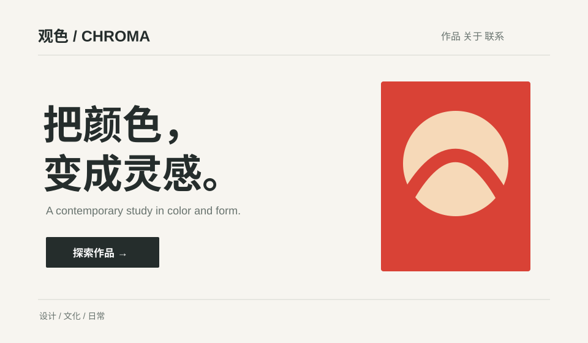

# 中国现代设计风 · Chinese Contemporary

## 视觉特征

现代网格与中文排版结合克制的中国红、留白和抽象几何。

## 常见用途

中国品牌、文化科技、现代产品。

## 示例配色

`#f7f5f0 · #d94236 · #252d2c`

## 使用时留意

不要把中国风简化为红金龙凤；先确定品牌与受众。

> 图片是原创的示意界面，用于表达风格，不代表任何现成产品的完整设计规范。
