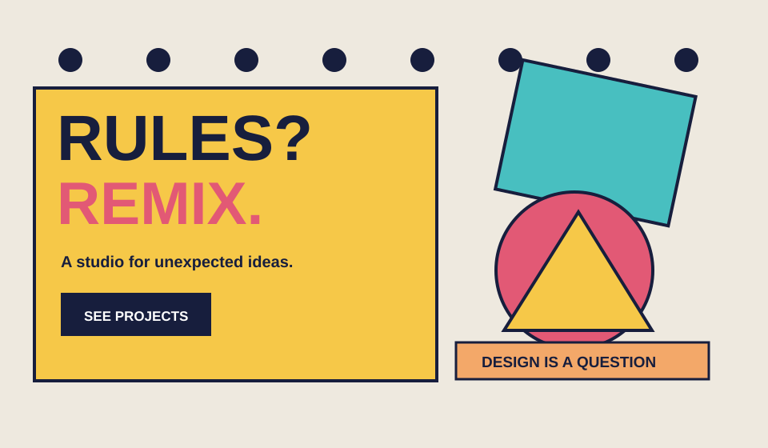

# 后现代风 · Postmodern / Memphis-inspired

## 视觉特征

不对称构图、几何拼贴、鲜明配色和风格混搭，带有戏谑感。

## 常见用途

创意工作室、时尚、艺术活动。

## 示例配色

`#f6c848 · #e25975 · #48bfc0`

## 使用时留意

后现代不是任意堆叠；文字、导航和操作仍需清晰。

## 进一步参考

- [V&A：什么是后现代主义](https://www.vam.ac.uk/articles/what-is-postmodernism)

> 图片是原创的示意界面，用于表达风格，不代表任何现成产品的完整设计规范。
